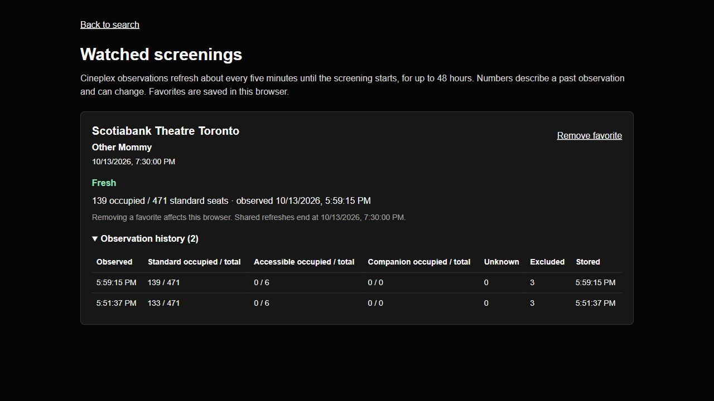

# AWS verification — October 13, 2026

The isolated demo was deployed in us-east-2. It exercised EventBridge Scheduler, SQS, Lambda and DynamoDB; the production website was not changed.

A fixture refresh stored one observation. Redelivering the completed job left history at one entry and incremented the duplicate counter. A malformed fixture produced a terminal failure and one dead-letter message without inventing a seat observation.

For Other Mommy at Scotiabank Theatre Toronto (7:30 PM Eastern), a manual dispatch stored 133 occupied standard seats out of 471 at 21:51:37 UTC. A subsequent scheduled dispatch stored 139/471 at 21:59:15 UTC. Both observations had zero unknown seats. The AWS-backed local browser displayed both history entries and preserved its favorite after reload.

The scheduled test had an enforced ten-minute end date. Infrastructure rejects polling windows over fifteen minutes or missing an end date. After verification, the schedule was explicitly disabled and all three test watches were paused. Six new infrastructure tests pass, alongside the previously verified 92 application tests, type checks and build. The bounded polling configuration was deployed successfully.

The demo stack and CDK bootstrap remain available. One intentionally failed fixture remains in the dead-letter queue. Idle alarms and retained storage can consume credits; disabled polling is not a zero-cost guarantee. See [deployment, cost assumptions and teardown](background-watches.md). This short test does not establish long-running reliability, cloud crash recovery or production capacity.
