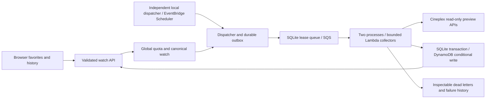

# Background Cineplex watches

A visitor saves a screening from either search theme, then sees timestamped
availability on `/watches`. The browser saves up to ten screening IDs; no new
account system is required. The shared service confirms cinema, timezone,
title and start time with Cineplex. Client metadata cannot change the watch.
Landmark's existing browser behavior is preserved and has no background worker.

## Architecture



The local SQLite adapter uses WAL and `BEGIN IMMEDIATE`, so independently
running processes share durable queue claims and atomic watch updates. The
AWS adapter uses strongly consistent reads plus version-conditional writes.
Registration commits the watch and registry together using a SQLite transaction
or DynamoDB transaction. Mutators contain no external side effects and can
be retried on a CAS conflict.

The dispatcher stores a job before publishing, and marks publication only
after queue acceptance. An interruption can repeat a delivery, but cannot lose
the persisted job. Each screening/5-minute slot has a stable job key. Delivery
is at least once. The collector claims a token with a 30-second lease, persists
under that token/version, and then acknowledges. A stale owner cannot commit
after another owner claims the job; an expired lease is checked again whenever
a CAS mutation retries. Hosts must have synchronized clocks. AWS clock skew and
service-level failure behavior require deployment verification.

Storage marks a refresh complete before queue acknowledgement. A crash at that
boundary leaves one observation; replay acknowledges without collecting again.
History is unique by job key. Latest observations advance only if both scheduled
refresh order and observation time advance. A delayed older job can appear in
history without replacing latest. Counts distinguish standard, accessible,
companion, unknown and excluded entries. Missing maps produce a failure rather
than an empty auditorium.

## Limits and freshness

| Setting | Local default | Prepared AWS demo |
| --- | --- | --- |
| Global active watches | 50 | 3 |
| Global registration attempts/hour, including invalid attempts | 20 | 6 |
| Browser favorites | 10 | 10 |
| Watch duration | Until start; at most 48 hours | Same |
| Refresh interval | 5 minutes | Same |
| Discovery reservation | 90 seconds | Same |
| Collection attempts | 3 | Same |
| Retry delays | 60, then 120 seconds | Same |
| Stored observations/failures | 24 each | Same |
| Retained refresh jobs | 64 | Same |
| Expired record retention | 7 days | DynamoDB TTL, deletion is asynchronous |

`WATCH_MAX_ACTIVE` and `WATCH_MAX_REGISTRATIONS` can lower server limits, never
raise them above the local defaults. A browser identifier cannot bypass global
quotas. Joining a watch cannot extend its expiry. Ended screenings release
capacity; interrupted registration reservations release after 90 seconds.
When an outage fills the job window, dispatch stops adding jobs until old jobs
settle, rather than growing a DynamoDB item indefinitely.

The freshness target is an observation younger than ten minutes under a healthy
provider/queue, with five-minute polling and a 15-second UI read interval. This
is a design target, not a measured cloud SLO. A failed current refresh marks an
existing observation stale. No observation plus a failure is unavailable.
Unknown statuses make data partial. Pending, paused and ended are distinct.
Cinema availability can change between the observation and ticket purchase.

## Local operation

Use Node 22.17+ (verification used Node 24.21.0). Each terminal must use the same
absolute working directory and database path. SQLite belongs on a persistent
local host; do not enable the local adapter on serverless temporary storage.

```powershell
npm ci
$env:WATCH_BACKEND='local'
$env:WATCH_MODE='fixture'
$env:WATCH_DB_PATH='.watch-data/watches.sqlite'
npm run dev -- -p 4311
```

In three additional terminals with the same variables, run a dispatcher and
two workers:

```powershell
npm run watch:dispatcher
```

```powershell
npm run watch:worker
```

The fixture page provides healthy, partial, timeout and malformed examples.
Registration and periodic dispatch produce jobs; the dispatcher wakes every
ten seconds locally and skips non-due watches. The cloud schedule wakes every
five minutes. A worker's JSON log includes PID, job key, queue age, duration and
outcome. Failure tests use synthetic provider-shaped responses.

Operations:

```powershell
npm run watch:ops -- inspect
npm run watch:ops -- export .watch-data/export.json
npm run watch:ops -- pause cineplex-7402-900001
npm run watch:ops -- resume cineplex-7402-900001
npm run watch:dispatcher -- --once
npm run watch:verify
```

Pause/resume is operator-only. It is not exposed as a public browser mutation.
Inspect failure codes and queue `dead_reason` before retrying; a terminal refresh
is not automatically revived. A later scheduled refresh can collect again.
Temporary failures retain delayed queue deliveries. Expired processing leases
become claimable; a repeated interruption eventually becomes a visible terminal
failure. The dispatcher recovers unpublished jobs after an interrupted publish.

Stop each terminal with Ctrl+C. Export if needed, then remove only the chosen
local demo database and its WAL/SHM companions after all processes have stopped:

```powershell
$demoRoot = [IO.Path]::GetFullPath('.watch-data')
$projectRoot = [IO.Path]::GetFullPath('.')
if (-not $demoRoot.StartsWith($projectRoot + [IO.Path]::DirectorySeparatorChar)) { throw 'Unexpected cleanup path' }
Remove-Item -LiteralPath "$demoRoot/watches.sqlite", "$demoRoot/watches.sqlite-wal", "$demoRoot/watches.sqlite-shm" -ErrorAction SilentlyContinue
```

## Prepared AWS demo

`infra/app.ts` defines one CDK stack in `ca-central-1`: an on-demand DynamoDB
table, refresh queue, seven-day dead-letter queue, dispatcher, collector and
IAM-only operations function, a disabled EventBridge Scheduler schedule,
three alarms and four custom metric filters. Lambda collectors have concurrency
two, 256 MB memory and a 30-second timeout. Queue visibility is 180 seconds;
partial batch responses retry only failed records. Poison messages have native
SQS redrive as a fallback; application terminal failures are also sent to the
DLQ and recorded in the watch. Repeated DLQ entries remain possible on a crash.

The runtime roles have only table GetItem/PutItem access and the required queue
actions. DynamoDB transactions authorize the underlying item operations. The
Scheduler role can invoke only the dispatcher and write its DLQ. No public
Lambda URL, NAT gateway, VPC, API key service or paid cinema API is provisioned.
Credentials stay server-side. Log groups retain seven days. Queue age, failed
refreshes and dead letters have alarms; successes, failures, observation age and
worker duration have metrics/logs. Alarms have no email/SMS actions.

Local preparation, without an AWS account:

```powershell
npm run infra:synth
npm run infra:verify
```

The default stack uses fixture collectors and disabled polling. The template
and bundled Lambda assets have been validated locally. This is not evidence of
actual AWS operation or Cineplex access from Lambda.

**Do not execute deployment commands until the maintainer verifies an eligible
Free plan and service access, or explicitly approves
the concrete cost path.** Do not choose/upgrade a Paid plan or assume credits
authorize charges. The local workflow remains the free alternative.

After that decision, the operator should:

1. Confirm account identity/region and plan in Billing (the Free Tier
   `GetAccountPlanState` API is another read-only option); verify service access,
   current regional prices and quotas. Review `cdk diff` and the generated IAM.
2. Bootstrap only the intended account/region if needed, then deploy the isolated
   stack with polling still disabled. Save the outputs and account/stack identity.
   CDK bootstrap assets are separate from the application stack.
3. Invoke the IAM-only operations Lambda with `action: register`, theatre `7402`
   and fixture showtime `900001`. Confirm the actual SQS queue, Lambda log,
   DynamoDB history and alarms. Test duplicate delivery and one failing fixture
   without claiming exactly-once messaging.
4. Invoke `action: probe` with a current real screening's numeric identifiers.
   This explicitly performs one read-only provider check from Lambda. Stop if
   Cineplex cannot be confirmed; do not enable repeated live polling.
5. If access and costs remain approved, deploy with CDK context `enableLive=true`
   and `enablePolling=true`. Run no more than three watches for 15 minutes, then
   disable the schedule again. Verify real observation timestamps, queue age,
   retry behavior, the UI using `WATCH_BACKEND=aws`, and CloudWatch metrics.
   Configure the local Node server's `WATCH_TABLE`, queue/DLQ URLs and default
   AWS credentials using an appropriately scoped role/profile. This preparation
   does not replace or deploy the existing Vercel application.
6. Export retained observations before `cdk destroy`. This demo uses DESTROY
   removal policies for its table, queues and log groups. Verify schedule,
   functions, alarms, queues, table and log groups are gone. Remove application
   asset versions from the dedicated bootstrap bucket only after verifying no
   other stack uses them; do not delete a shared bootstrap stack blindly.

## Cost assumptions and capacity

The sizing script constructs 24 snapshots, 24 failure entries and 64 jobs. Its
serialized fixture watch is **29,239 bytes**, approximately 29 write units for a
full Put and eight strongly consistent read units. JSON serialization is a size
proxy, not an exact DynamoDB attribute-size measurement. Planning uses a 48 KB
envelope per watch; actual provider metadata and DynamoDB size must be checked
on deployment. The bounded demo avoids scanning and uses three watches. A
refresh needs about four full-document writes (dispatch, publication, claim,
commit) and several reads. This intentionally simple aggregate/CAS model is
suitable for a small demo, not a claim of large-scale capacity efficiency.

On-demand ceilings are 64 read and 256 write request units/second, allowing
bounded multi-KB bursts from two workers. They are **throughput ceilings, not
monetary caps**. Conditional conflicts and throttling use bounded retries; an
exhausted handler retry leaves the SQS record unacknowledged. Cloud latency,
contention, visibility recovery and clock skew still need real verification.

Conservative planning rates in USD, before any free usage/credits: $2 per
million write units, $0.50 per million read units, $0.25 per million Lambda
requests, $0.00002/GB-second, $0.50 per million SQS operations, $1/GB logs,
$0.35 per custom metric/month and $0.15 per standard alarm/month. These are
deliberately padded assumptions, not a current regional quote. Check the AWS
calculator for `ca-central-1` and account-specific availability before approval.

| Workload | Planning estimate before credits |
| --- | --- |
| Three watches, 15 minutes, roughly 12 refreshes with mature 48 KB documents | $0.02–$0.05 incremental requests/compute/logs, assuming bounded retries and at most 100 Lambda invocations; plus prorated monitoring |
| Three watches running continuously for 24 hours, 864 refreshes | About $0.35–$0.65/day at the conservative item envelope and function timeouts; excludes extra UI/read traffic and repeated infrastructure failures |
| Stack left idle, schedule disabled, no metric publication | Up to $0.45/month for three alarms, plus small retained table/log/bootstrap storage |
| A month with four custom metrics publishing regularly | Up to $1.40/month for metrics in addition to alarms/storage |

The 48-hour watch expiry, global quotas and bounded concurrency reduce useful
work, but do not cap arbitrary account costs or external traffic. Billing
alerts can lag and are not a hard cap. Destroying the isolated demo after the
15-minute run limits ongoing resources. No cloud resource or charge has been
created by this implementation.

Sources checked October 13, 2026: [Free Tier FAQ](https://aws.amazon.com/free/free-tier-faqs/),
[DynamoDB pricing/unit sizing](https://aws.amazon.com/dynamodb/pricing/),
[Lambda pricing](https://aws.amazon.com/lambda/pricing/),
[SQS pricing](https://aws.amazon.com/sqs/pricing/),
[CloudWatch pricing](https://aws.amazon.com/cloudwatch/pricing/),
[CloudWatch billing](https://docs.aws.amazon.com/AmazonCloudWatch/latest/monitoring/cloudwatch_billing.html),
[SQS/Lambda errors and partial batches](https://docs.aws.amazon.com/lambda/latest/dg/services-sqs-errorhandling.html),
[DynamoDB concurrent updates](https://docs.aws.amazon.com/amazondynamodb/latest/developerguide/BestPractices_ImplementingVersionControl.html),
[Scheduler state](https://docs.aws.amazon.com/scheduler/latest/UserGuide/managing-schedule-state.html).

## Five-minute design/demo guide

1. **Minute 1:** Open `/watches` in fixture mode. Save healthy, partial and
   malformed examples. Explain that browser favorites are separate from global,
   canonical watches; show pending without inventing seat counts.
2. **Minute 2:** Start the dispatcher and two worker terminals. Refresh the page
   to show observed/storage timestamps, separate accessibility counts, partial
   unknown data, and unavailable/terminal failure details.
3. **Minute 3:** Run `npm run watch:verify`. Show two worker PIDs, 24 unique jobs
   from 48 deliveries, and delayed older snapshots preserving the latest order.
4. **Minute 4:** Show the crash/recovery and fenced-lease evidence. Explain the
   separate durable store and acknowledgement boundary, stable refresh keys,
   version CAS, retry limits and dead-letter inspection.
5. **Minute 5:** Open `infra/app.ts` and `aws-preparation.json`. Show disabled
   polling, fixture mode, three-watch quota, Lambda concurrency, monitoring,
   size/cost assumptions and teardown. State clearly that AWS deployment and
   provider access from Lambda require account/cost approval and deployment verification.
