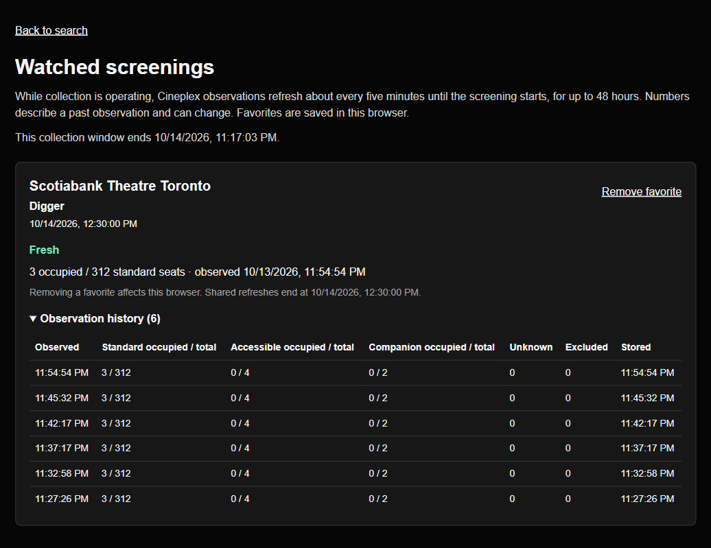

# Production release evidence

**Released and verified on the public website.** Initial application/infrastructure
code: `7f3354d724d86e212a83b915d09f3dbaeae18b0e`, [PR #6](https://github.com/Parsa-Bagheri/HowManySeats/pull/6).
Initial tested production deployment: `dpl_87m6FBawmHgTwyaccqgRE96Ru3TN`.
Verification snapshot: 2026-10-14T04:06:11.305553+00:00 (UTC). Final merge/deployment identifiers are
recorded in PR #6 and the private release manifest.

The normal public site uses AWS storage, real Cineplex collection and private,
scoped service credentials. Public status returned enabled=true, fixture=false,
accepting=true. Vercel remains Hobby and AWS remains FREE/ACTIVE. No account-plan,
domain or deployment-protection change was made.

## Browser and deployed flow

A future Digger screening at Scotiabank Theatre Toronto (October 14, 12:30 PM
Eastern) was discovered through deployed search, registered through the staged
production API, then favorited through the normal public “Watch availability”
button. The favorite and visible history survived browser reload. The actual
web/API/queue/Lambda/DynamoDB path stored a live initial observation and later
scheduled refreshes. Snapshot data included these UTC observation times:

- 2026-10-14T03:27:26.973000+00:00 — 3/312 standard seats occupied.
- 2026-10-14T03:32:58.732000+00:00 — 3/312 standard seats occupied.
- 2026-10-14T03:37:17.952000+00:00 — 3/312 standard seats occupied.
- 2026-10-14T03:42:17.768000+00:00 — 3/312 standard seats occupied.
- 2026-10-14T03:45:32.182000+00:00 — 3/312 standard seats occupied.

The screenshot subsequently captured six retained observations. Unchanged counts
still represent different timestamped collections. Counts are observations, not
guaranteed ticket availability. Interactive Cineplex search displayed six Digger
showtimes; a separate public Landmark Waterloo search displayed 29 showtimes
with live seat counts. Background workers support Cineplex only.

## Duplicate prevention, pause and monitoring

One completed real job was redelivered through the actual production SQS queue.
Its history count remained one, the duplicate counter advanced from zero to one,
and the latest observation did not regress. This verifies application-level
duplicate suppression for this check, not exactly-once queue transport.

The deployed IAM-only pause operation and disabled schedule rejected public
registration with HTTP 503 while preserving readable history marked paused.
Resume restored the original deadline and only watches previously unpaused.
Final public status returned accepting=true. No polling window was extended.

CloudWatch collector logs showed stored real refreshes and duplicate-or-inactive
redelivery. Published metrics included three RefreshSuccesses datapoints and four
WorkerDurationMs/ObservationAgeMs datapoints in the checked interval; no production
RefreshFailures datapoints were observed. The existing malformed fixture dead
letter was verified, privately archived and removed by its individual receipt;
the DLQ then reported zero visible/in-flight messages. Its alarm can lag that
cleanup until the next evaluation window. Alarms have no notification actions;
actual notification delivery was not tested.

## Limits and verification scope

- Final schedule: ENABLED, rate(5 minutes), enforced end `2026-10-15T03:17:03.1281272Z`
  (October 14, 11:17:03 PM Eastern).
- Three active watches, six registration attempts/hour, two workers; unchanged
  48-hour screening lifetime, 24 observations/failures, 64 jobs, three attempts,
  fenced 30-second leases, 60/120-second retry delays and seven-day record retention.
- Scheduler, Lambda/web runtime and IAM Put/send permissions share the deadline.
  Production data is namespaced separately from retained demo records.
- 102 application tests, nine infrastructure-window tests, typecheck, production
  build and demo/disabled/enabled production template assertions passed. Production
  dependency audit: zero advisories; development dependency advisories remain.
- Fresh local replay: two processes, 24 jobs/48 deliveries, zero duplicate history
  or latest regressions; crash-after-store recovery and expired-worker rejection.
  Retry/failure/partial-batch coverage remains passing. A real provider failure
  was not deliberately forced during this production pilot.
- No current nationwide 185+ theatre census or 600+ showtime production benchmark
  was established. No claim of sustained availability, load-tested capacity,
  exactly-once transport or delivered alarm notifications is supported.

See [configuration, costs and rollback](production-release.md). Raw AWS outputs,
resource identifiers, key metadata, full logs and request/response evidence remain
in the workspace's private evidence area, outside public commits.
