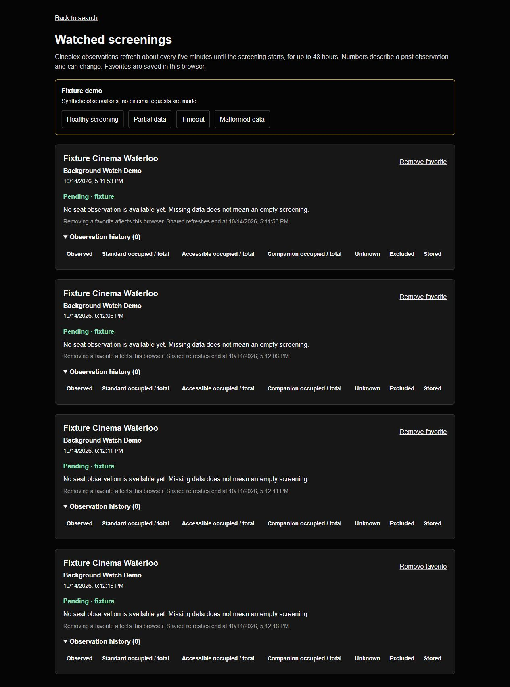
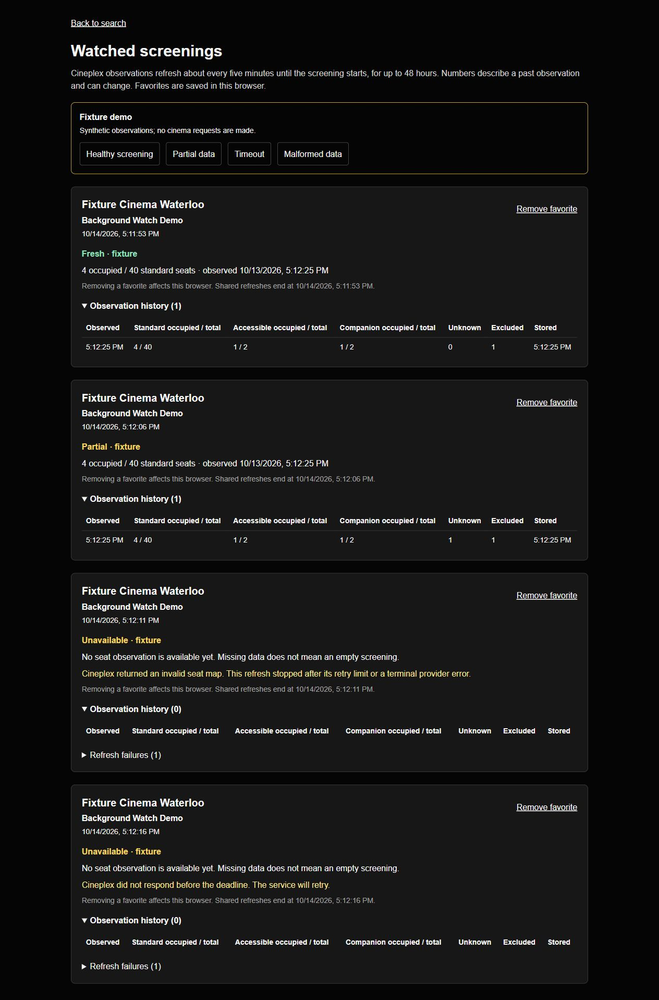

# Background watch verification

Baseline: `c019b437cde0e529127bb2a9d435740958faa9a4` (current main at fetch).
The isolated feature branch is `feature/5-background-watches`, linked to
[issue #5](https://github.com/Parsa-Bagheri/HowManySeats/issues/5). The original
checkout and its untracked local handoff were preserved. Verification used
Windows x64, Node 24.21.0, SQLite WAL and synthetic provider-shaped fixtures.
No live provider benchmark, AWS resource, production deployment or charge was
performed.

## Completed checks

| Check | Result |
| --- | --- |
| Baseline tests/typecheck/build | 73 tests passed; TypeScript and production build passed |
| Current `npm test` | 92 passed, 0 failed, including all original tests |
| Current `npm run typecheck` | Passed |
| Current `npm run build` | Passed; existing Edge/static-generation and outdated Browserslist warnings |
| `git diff --check` | Passed |
| `npm run watch:verify` | Actual independent worker processes, duplicate/delayed delivery, store-before-ack process exit and expired-lease recovery passed |
| `npm run infra:synth` | CDK template and 738.8 KB Lambda bundle synthesized locally |
| `npm run infra:verify` | Disabled polling, fixture mode, quotas, IAM scope, visibility/timeout, partial-batch response and aggregate size assertions passed |
| Browser production server, port 4311 | Browser action → API → durable queue → worker → database → timestamped UI confirmed |

Independent reruns of `npm test` and the real process replay passed;
the replay artifacts contain the latest run. Exact timings below are an
individual local run with startup/drain time included, not a production SLO.

## Measured real-process replay

See [watch-replay.json](evidence/watch-replay.json) and
[watch-replay.log](evidence/watch-replay.log).

- 12 watched screenings, 24 unique refresh jobs and 48 deliveries.
- Worker PIDs 29496 and 17212 both stored observations.
- Replay elapsed 4,801 ms, approximately 5.00 unique jobs/second including
  worker startup and idle drain. Injected collector delay: 50 ms.
- Stored-job duration p50 95 ms, p95 106 ms. Test queue/domain lease: 2 seconds.
- Zero duplicate history entries and zero latest-observation regressions.
- A separate worker actually exited with code 86 immediately after storage,
  before acknowledgement. Replay preserved one history entry and emptied the
  queue without collecting again.
- An old worker with an expired 300 ms lease was fenced after its replacement
  stored the result. One history entry and one fenced commit were recorded.
- Entire replay/recovery suite elapsed 9,927 ms.

Unit checks additionally cover expired success/failure without a replacement,
60/120-second retry backoff and attempt exhaustion, malformed/404/rate-limit
responses, missing map handling, mixed Lambda batch outcomes, optimistic-lock
conflicts, atomic registration, bounded throttling/retry exhaustion, actual
1 KB API body bounds without Content-Length, canonical provider metadata,
ended-capacity release, reservation recovery, stale/partial state and bounded
history/jobs during an outage. AWS SDK tests use injected transports, not AWS.

## Browser evidence

The production build ran locally with `WATCH_BACKEND=local`, `WATCH_MODE=fixture`
and `.watch-data/browser-demo.sqlite`. The browser saved four fixture screenings
through the actual API, saw pending states, then a real worker PID 33932 stored
two observations and recorded a retry/terminal failure. Reloading retained all
four browser favorites and showed fresh, partial and unavailable states.
No browser warning/error log entries were captured. Accessibility tables expose
standard, accessible, companion, unknown, excluded, observed and stored values.

## AWS evidence and remaining dependency

[aws-preparation.json](evidence/aws-preparation.json) contains template assertions
and the measured 29,239-byte mature fixture aggregate. The conservative envelope
is 48 KB; on-demand limits are 64 read/256 write units per second with three
active watches. See the operations guide for cost assumptions and cleanup.

AWS deployment remains a separate prerequisite: account plan, free-plan
eligibility/service access and cost approval must be verified. The prepared code
has not demonstrated cloud queue/database/monitoring behavior or Cineplex
access from Lambda. An eligible account or explicit approved cost path, scoped
credentials, an isolated deployment and an actual provider probe are required.
Existing production remains unchanged. Landmark background collection is
outside this change.

## Factual resume bullet drafts

- Implemented a durable background screening-watch service with independent
  workers, fenced leases, delayed retries and idempotent snapshots; verified
  24 refresh jobs across 48 deliveries with zero duplicate history or latest
  observation regressions in a two-process fixture replay.
- Built timestamped availability history and failure states with global quotas,
  SQLite persistence and DynamoDB/SQS adapters; prepared and locally validated
  an AWS CDK stack for Scheduler, Lambda collectors and bounded monitoring.

The second bullet deliberately says prepared rather than deployed. Reword with
actual cloud measurements only after the cloud verification is completed.
